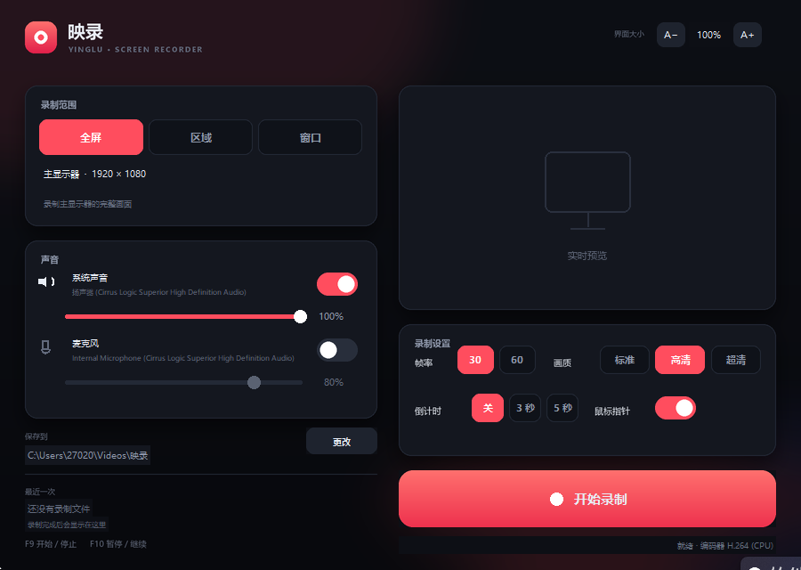

# 映录 · Windows 屏幕录制

一个本地运行的轻量录屏软件：全屏 / 框选区域 / 指定窗口，支持系统声音与麦克风、暂停续录、全局热键，直接输出 MP4（H.264 + AAC）。

界面使用 Tkinter 自绘（PIL 抗锯齿圆角、深色主题），录制管线为 `mss` 抓屏 → `ffmpeg` 编码，不依赖任何云端服务。



## 功能

- **三种录制范围**：主显示器全屏、鼠标框选任意区域、指定窗口（窗口移动自动跟随）
- **声音**：系统声音（WASAPI loopback）与麦克风，可分别开关、独立调节音量，设备可切换
- **暂停 / 继续**：暂停期间画面和声音都会被剪掉，成片不会留下空档
- **全局热键**：`F9` 开始 / 停止，`F10` 暂停 / 继续
- **悬浮控制条**：开始录制后主窗口自动隐藏，顶部悬浮条显示时间与大小，可拖动；已设置为**不被录进画面**
- **实时预览**：录制前预览当前画面，录制中可随时打开主窗口查看
- **高帧率抓屏**：优先 DXGI 桌面复制（1080p 可跑满 60fps），不支持时自动回退 GDI/mss
- **画质选项**：30 / 60 fps，标准 / 高清 / 超清，自动检测硬件编码器（NVENC / QSV / AMF，实测明显更快才启用，否则用 x264）
- **倒计时**：0 / 3 / 5 秒
- **界面缩放**：右上角 `A− / A+` 五档（90% / 100% / 110% / 125% / 150%），主界面、悬浮条和对话框同步缩放，设置自动保存
- **鼠标指针**：可开关，按 alpha 正确合成，不是硬贴图
- **最近录制**：记住上一次的成片，一键打开所在文件夹

## 快速开始

要求：Windows 10（2004+）/ Windows 11。

**方式一：免安装版（推荐）**

直接运行 `dist\Yinglu\Yinglu.exe`，不需要安装 Python。整个 `dist\Yinglu` 文件夹需要一起保留（其中是运行库与 ffmpeg）。

**方式二：源码运行**

需要 Python 3.9+（安装时勾选 Add to PATH）。

1. 双击 `start.bat`。首次运行会自动调用 `setup.bat` 创建 `.venv` 并安装依赖。
2. 如果自动安装失败，可手动执行：

```bat
python -m venv --system-site-packages .venv
.venv\Scripts\python.exe -m pip install -r requirements.txt
```

3. 之后双击 `start.bat` 启动；也可以命令行运行 `.venv\Scripts\pythonw.exe run.pyw`。

首次启动会生成 `config.json` 和 `assets/` 图标。想重新打包 exe 时运行 `build_exe.bat`。

## 使用

| 操作 | 说明 |
| --- | --- |
| 录制范围 | “区域”点击“选择区域”后拖动框选，`Enter` 确认、`Esc` 取消；“窗口”从窗口列表中点选 |
| 保存位置 | 默认 `视频\映录`，点“更改”选择其他文件夹 |
| 开始 / 停止 | 点红色按钮，或按 `F9` |
| 暂停 / 继续 | 主界面“暂停”按钮或 `F10`；录制中也可用悬浮条 |
| 界面大小 | 右上角 `A−` / `A+` 在 90%–150% 间切换，立即生效；录制中不可调整 |
| 打开主窗口 | 点击悬浮条最右侧的展开按钮 |

输出为 `录屏 YYYY-MM-DD HH-MM-SS.mp4`，H.264 + AAC，兼容常见播放器与剪辑软件。

## 说明与限制

- **系统声音**：如果 Windows 输出被静音或音量为 0，录到的系统声音就是静音，这是 WASAPI loopback 的正常行为。
- **麦克风**：默认选择第一个非虚拟麦克风；点击设备名可切换。虚拟声卡（VB-Audio 等）默认不列入。
- **窗口录制**：窗口最小化时画面会停住；窗口内容变化时按实际窗口尺寸抓取。
- **性能**：优先使用 DXGI 桌面复制，1080p60 在支持的环境可跑满；DXGI 不可用时自动回退 GDI（1080p 约 30fps），抓屏跟不上时会补重复帧保持时长与音画同步。
- **界面缩放**：只改变软件界面大小，不影响录制分辨率；若当前屏幕放不下所选档位，会自动收一档。
- **热键冲突**：若 `F9` / `F10` 被其他程序占用，界面按钮仍然可用，启动时会提示。
- **隐私**：全程本地处理，不上传任何数据。

## 目录结构

```
yinglu/
├─ yinglu/
│  ├─ capture.py      抓屏（DXGI 优先，失败回退 mss；全屏/区域/窗口；鼠标合成）
│  ├─ engine.py       录制引擎（帧节奏、暂停、收尾封装）
│  ├─ audio.py        系统声音 / 麦克风（soundcard）
│  ├─ ffmpeg.py       ffmpeg 定位、编码器探测、混流
│  ├─ winutil.py      DPI、窗口枚举、光标位图
│  ├─ hotkeys.py      全局热键
│  ├─ single_instance.py  单实例互斥
│  ├─ config.py       配置
│  └─ ui/             自绘界面（paint / widgets / 主窗口 / 选区域 / 选窗口 / 悬浮条）
├─ docs/screenshot.png
├─ run.pyw
├─ start.bat          源码启动
├─ setup.bat          安装依赖
├─ build_exe.bat      打包独立 exe
├─ dist/Yinglu/       免安装版（Yinglu.exe + 运行库）
└─ requirements.txt
```

## 技术栈

Python 3.11 · Tkinter · Pillow · mss · dxcam（DXGI）· soundcard · ffmpeg（imageio-ffmpeg 自带二进制）· pywin32
